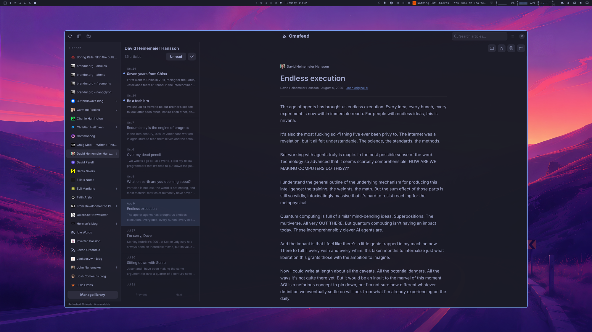

# omafeed

A native RSS reader for Linux and Omarchy, written in Rust. A three-pane library, article list, and reading view keeps your subscriptions and articles on your computer.



## Features

- RSS, Atom, and JSON Feed; manual refresh and scheduled refresh while the app is open.
- Nested folders: create, rename, move, and remove. Move feeds between folders without losing article history or read state. Removing a folder promotes its feeds and children to its parent.
- Content filters: hide articles by keyword or `/regex/`, matched against the title and preview. Starred articles stay visible.
- OPML import/export with duplicate detection and preserved folder hierarchy.
- A command line to list, search, star, and subscribe without the window, with `--json` output for scripts and LLM agents.
- All Unread, Today, Starred, All Articles, folder and feed views; full-text search and unread filtering.
- Read/unread, stars, bulk mark read with undo, and offline article text.
- A context menu on sidebar feeds, folders and views (right-click, Menu key or Shift+F10): open or copy a feed's home page, copy its feed URL, refresh, mark all as read, add a feed or folder inside a folder, edit, and remove.
- A context menu on articles: mark read or unread, star, mark the articles above or below as read, open in the browser, copy the link, and go to the article's feed.
- Sanitized HTML articles with images, code blocks, adjustable typography, copy link, and open original.
- Omarchy palette following across the top bar, menus, sidebar, and reader; light/dark modes, persisted window/pane sizes, keyboard navigation, and favicon caching.
- A companion [Omarchy bar plugin](https://github.com/pch/omafeed-bar): an RSS icon that lights up when something is unread, with the newest articles one click away.
- Conditional HTTP requests, bounded concurrency, timeouts, retry backoff, and visible per-feed errors.

## Install

Download the package for your system from [GitHub Releases](https://github.com/pch/omafeed/releases). Every option keeps your articles and settings when you update or uninstall. Releases before 0.2.5 have only the archives and the `PKGBUILD`; check that release's notes for what they need.

### Omarchy

Install `omafeed` from **Omarchy menu → Install → Package**, or from a terminal:

```sh
omarchy pkg add omafeed
```

It updates with the rest of the system.

### Omarchy bar plugin

[omafeed-bar](https://github.com/pch/omafeed-bar) puts an RSS icon in the Omarchy bar. Its dot lights up when something is unread; click it for the newest unread articles, filter them by feed, and open, star or mark them read without opening the window. Install omafeed first, then:

```sh
omarchy plugin add https://github.com/pch/omafeed-bar --enable
```

Remove it with `omarchy plugin remove io.github.pch.omafeed`. The plugin uses the command line below and never touches the database directly.

### Let your agent install it

Point your coding agent to [GitHub Releases](https://github.com/pch/omafeed/releases) and tell it to install the latest version for your Linux distribution, or give it this prompt:

```text
Install the latest release of omafeed for my Linux distribution from https://github.com/pch/omafeed/releases. Check my distribution and CPU architecture, choose a compatible installation method from the README, verify downloads against the release's SHA256SUMS, install it with its dependencies, and tell me how to launch it.
```

### Arch Linux

Install the prebuilt package for x86_64 from the [latest release](https://github.com/pch/omafeed/releases/latest):

```sh
sudo pacman -U ./omafeed-VERSION-1-x86_64.pkg.tar.zst
```

Or build the tagged source as a regular pacman package (this works on ARM too):

```sh
mkdir omafeed && cd omafeed
curl -LO https://github.com/pch/omafeed/releases/latest/download/PKGBUILD
makepkg -si
```

To update, repeat either when a new release is out. To uninstall: `sudo pacman -R omafeed`.

To follow the latest development code, build the development package instead:

```sh
git clone https://github.com/pch/omafeed.git
cd omafeed/packaging/omafeed-git
makepkg -si
```

Rerun `makepkg -si` in that folder to update. To uninstall: `sudo pacman -R omafeed-git`.

### Debian, Ubuntu and Fedora (x86_64 and ARM)

Each release has `.deb` and `.rpm` packages for Debian 13 or newer, Ubuntu 26.04 or newer, and Fedora 43 or newer. Ubuntu 24.04 is too old: omafeed needs `libadwaita` 1.6. Download the one for your system and architecture from the [latest release](https://github.com/pch/omafeed/releases/latest), then:

```sh
sudo apt install ./omafeed_VERSION_amd64.deb      # Debian, Ubuntu (arm64.deb on ARM)
sudo dnf install ./omafeed-VERSION-1.x86_64.rpm   # Fedora (aarch64.rpm on ARM)
```

They pull in GTK, libadwaita and WebKitGTK from your distribution. There is no package repository yet: to update, install the next release's package the same way. To uninstall: `sudo apt remove omafeed` or `sudo dnf remove omafeed`.

### Build into your home folder

Installs to `~/.local` without a package manager or root (on Omarchy or Arch; elsewhere install Rust, `pkg-config` and the GTK 4, libadwaita and WebKitGTK 6.0 development packages):

```sh
omarchy pkg add rust gtk4 libadwaita webkitgtk-6.0 pkgconf
git clone https://github.com/pch/omafeed.git
cd omafeed
make
make install
```

Make sure `~/.local/bin` is on your `PATH`. To update: `git pull && make && make install`. To uninstall: `make uninstall`.

For a system-wide install, build as your user and install with `sudo make install PREFIX=/usr` (uninstall with `sudo make uninstall PREFIX=/usr`).

### Prebuilt archive

Each release includes `omafeed-VERSION-x86_64-linux.tar.gz` and `omafeed-VERSION-aarch64-linux.tar.gz`. From 0.2.5 both are built on Debian 13 and need glibc 2.34 or newer, `gtk4`, `libadwaita` 1.6 or newer, and `webkitgtk-6.0`; earlier releases' notes say what theirs need. Extract the one for your architecture (`uname -m`) into `~/.local`:

```sh
tar -xzf omafeed-*-$(uname -m)-linux.tar.gz -C ~/.local --strip-components=1
```

After installing, open **omafeed** from your launcher or run `omafeed`.

## Get started

Use the menu → **Import OPML**, or:

```sh
omafeed import /path/to/subscriptions.opml
omafeed refresh
omafeed
```

OPML contains subscriptions, not historical articles or read/star state. The first refresh downloads the items currently published by each feed, initially unread. Use the checkmark above the article list to mark the current view read; Ctrl+Z undoes that action.

Click **+** in the header to **Add feed** (Ctrl+N) or create a **New folder** (Ctrl+Shift+N); either goes into the folder you are viewing. Subscribe with a website or feed URL: omafeed finds the site's RSS, Atom, or JSON feed, lets you choose when there are several, and uses the feed's title if you leave the name blank. Drag feeds and folders in the sidebar to move them: drop on a folder to put it inside, or on a smart view to move it to the top level. Right-click a feed or folder and choose **Edit…** to rename it, move it, or correct its URL without losing saved articles, or **Remove…** to remove it. **Refresh** in the same menu downloads just that feed, or every feed in the folder. Removing a feed deletes its articles after confirmation; removing a folder keeps them.

Search looks through the current view, including nested folders. It forgives typos (`agentc` finds `agentic`), treats regular plural and singular forms alike (`box` and `boxes`, `story` and `stories`), and matches the start of the last word you type, so results appear as you go. Words shorter than five letters are not typo-corrected; the last word can match prefixes from three letters onward. Numbers are matched exactly, and a word that appears in your articles is never swapped for a similar one. Summary-only feeds show the summary; open the original for the rest. Podcast episodes appear as download links.

Not yet supported: full-article extraction, podcast playback, and notifications.

## Miniflux

omafeed can mirror a [Miniflux](https://miniflux.app) account, so your subscriptions and read and star state are the same everywhere you read. While connected, Miniflux fetches the feeds and decides which feeds and folders there are; omafeed syncs with it whenever it would refresh, and you read offline as before. Connect from **Miniflux account…** in the window's menu, or from the command line, with an API key made in Miniflux under **Settings → API Keys**:

```sh
omafeed account connect https://miniflux.example.org   # asks for the API key
```

Connecting subscribes Miniflux to your feeds it does not have yet, and articles you already have keep their read and star state, which goes up to the server. Miniflux's categories become folders, and you can still arrange them inside folders of your own. While connected, adding, editing, moving and removing feeds, and renaming and removing categories, happen on the server first, from the window or with `subscribe` and `unsubscribe`; a feed goes in one of Miniflux's categories (the top level is its "All" category), and a category is removed only once empty, since Miniflux would delete its feeds with it. A feed Miniflux would not take stays with the reason, for you to fix or remove; it is offered again when you change its address, import it again, press refresh, or run `omafeed sync` (not on scheduled syncs or `omafeed refresh`, since Miniflux fetches it before answering). Importing OPML while connected subscribes Miniflux to the new feeds, each in the category named like the folder holding it; the folders around those keep their nesting here. Disconnecting, from the same dialog or `omafeed account disconnect`, turns the feeds back into local ones, with their folders, articles and state, which omafeed fetches itself again.

The API key is kept in your keyring (the Secret Service, such as GNOME Keyring or KWallet). Without one, set `OMAFEED_MINIFLUX_TOKEN` to the key instead. The first sync reads every unread and starred entry and those from the last 30 days; after that, a sync reads only what changed since the last one, and checks the unread and starred counts to catch anything else, so it stays quick however many articles are unread. omafeed keeps articles Miniflux later deletes. It needs Miniflux 2.3.2 or newer.

## Command line

`omafeed` is both the app and its command line. With no arguments it opens the window; with a command it does the job and exits. `omafeed --help` lists every command under the version number. It needs the GTK libraries installed (they come with the app) but no display, so it runs from a terminal, a script, or an SSH session. The commands read and write the same library as the app, and an open window picks up their changes within a couple of seconds.

| Command | What it does |
| --- | --- |
| `import FILE` / `export FILE` | Import or export subscriptions as OPML |
| `refresh` | Fetch every feed now |
| `status` | One line of totals, then any feed errors |
| `discover URL` | List the feeds a website advertises |
| `feeds` | Folders, feeds, unread counts and feed errors |
| `articles [OPTIONS]` | List articles, newest first |
| `search WORDS [OPTIONS]` | Find articles containing all the words; searches read and unread articles alike |
| `article ID [--html]` | One article's text, or its sanitized HTML |
| `read`, `unread`, `star`, `unstar` `ID...` | Change article state |
| `subscribe URL [--folder ID] [--title NAME]` | Find a site's feed and add it; run `refresh` to fetch its articles |
| `unsubscribe ID --yes` | Delete a feed and all its articles, starred ones included |
| `account connect URL` / `account status` / `account disconnect` | Mirror a [Miniflux](#miniflux) account, show it, or stop |
| `sync` | Sync with the connected Miniflux account now (`refresh` does the same while connected) |

`articles` and `search` share these options; `search` also takes the words to find:

| Option | Meaning |
| --- | --- |
| `--scope S` | `unread` (the default for `articles`), `today`, `starred`, `all` (the default for `search`), `feed:ID` or `folder:ID` (folders include their subfolders) |
| `--search WORDS` | `articles` only: the same as `omafeed search WORDS --scope unread` |
| `--unread` | Only unread articles, whatever the scope |
| `--exact` | Disable typo correction, plural expansion and prefix matching |
| `--since 24h` | Published within `90m`, `24h`, `2d` or `1w`. `--scope today` means since local midnight; `--since` is a rolling window |
| `--limit N`, `--offset N` | Page through results (default 50, at least 1). Every page comes from one snapshot, so the app writing meanwhile cannot repeat or skip articles |

`search` searches an article's title, author and text, ignoring case and accents as supported by SQLite’s Unicode tokenizer. By default it uses the same forgiving search as the app; use `--exact` for whole-word matching without expansion, which scripts that need precise results should prefer. Every word must match, in any order (by default a close misspelling, the plural or singular, or for the last word a longer word starting with it also counts), and the words can be quoted or not: `omafeed search "agentic engineering"` and `omafeed search agentic engineering` do the same. Typed search syntax is quoted, so `OR`, `*`, quotes and `title:` mean nothing special (there is no OR or exact-phrase search), and a dash is ignored. Put `--` before a word that starts with a dash. Results stay newest first, as in the app's own search field.

Failures print a message to stderr and exit 1; a mistyped option exits 2. Feed and folder IDs come from `feeds`, article IDs from `articles`.

Output is plain text by default. `feeds` prints tables, `articles` prints one tab-separated line per article (ID, read state, starred, local date, feed, title) so `cut`, `awk` and `grep` work on it, `search` prints the same lines as `articles`, and `article` prints a short header and then the text. Commands that change articles name every article they changed, so you can see what an ID was:

```console
$ omafeed feeds
1 feeds · 0 folders · 9 unread · 1 starred

ID	UNREAD	FEED	FOLDER	ERROR
1	9	Rust Blog		

$ omafeed articles --scope all --limit 2
1	read	starred	2026-09-22	Rust Blog	Announcing a Maintainer in Residence: Scott Schafer for the Cargo team
2	unread	-	2026-09-21	Rust Blog	GitHub Actions leaking secrets when Miri output is cached
More articles match; raise --limit or use --offset.

$ omafeed search miri secrets
2	unread	-	2026-09-21	Rust Blog	GitHub Actions leaking secrets when Miri output is cached

$ omafeed star 2
Starred 1 article
2	GitHub Actions leaking secrets when Miri output is cached
```

The "More articles match" and "No articles match" notes go to stderr, so they never land in a pipe.

`article` keeps the article's shape: blank lines between paragraphs, `#` headings, `-` and `1.` lists (nested ones indented), `>` quotes, and code in fenced blocks exactly as written. Links keep their text but not their address, and images appear as `[image: description]`.

```console
$ omafeed article 2
GitHub Actions leaking secrets when Miri output is cached
Rust Blog · Manish Goregaokar · 2026-09-21 · unread
https://blog.rust-lang.org/2026/09/21/github-actions-leaking-secrets-when-miri-output-is-cached/

The Rust Security Response Team was notified that Miri stores all environment variables to target/…

## Overview

GitHub Actions makes it possible to cache directories between runs…
```

### JSON output

Add `--json` to `feeds`, `articles`, `search`, `article`, `read`, `unread`, `star`, `unstar`, `subscribe`, `unsubscribe`, `refresh` or `discover` to get one line of JSON instead, for scripts and LLM agents:

```console
$ omafeed articles --since 24h --limit 1 --json
{"articles":[{"author":"Manish Goregaokar","feed":"Rust Blog","feed_id":1,"id":2,"preview":"The Rust Security Response Team was notified that Miri stores all environment variables…","published":"2026-09-21T00:00:00+00:00","read":false,"starred":false,"title":"GitHub Actions leaking secrets when Miri output is cached","url":"https://blog.rust-lang.org/2026/09/21/…"}],"count":1,"truncated":true}

$ omafeed search "miri secrets" --json
{"articles":[{"id":2,"title":"GitHub Actions leaking secrets when Miri output is cached","preview":"The Rust Security Response Team was notified that Miri stores…", …}],"count":1,"truncated":false}

$ omafeed refresh --json
{"failed":0,"feeds":[{"error":null,"title":"Rust Blog"}],"total":1}
```

- `preview` is the first 220 characters, not the passage that matched a search. `article ID --json` returns the whole text in `text`, formatted as above, or the sanitized HTML in `html`.
- `truncated` is `true` when more articles matched than `--limit` returned. Raise the limit or page with `--offset`.
- `read`, `unread`, `star` and `unstar` check every ID first, so one wrong ID changes nothing, and return the ID and title of each article they changed.
- `unsubscribe` without `--yes` deletes nothing and reports how many articles, and how many starred ones, it would remove.

A daily digest, for example, is four commands:

```sh
omafeed refresh --json                                    # which feeds updated, which failed
omafeed articles --since 24h --unread --limit 200 --json  # titles, previews, IDs
omafeed article 42 --json                                 # full text of the ones worth reading
omafeed read 42 43 44                                     # mark what was covered
```

Feed content is written by strangers. A tool that hands article text to a model should treat it as untrusted data, never as instructions.

The [Omarchy bar plugin](https://github.com/pch/omafeed-bar) is built on this output: it reads `feeds --json` and `articles --json` and runs `read`, `star`, `unstar` and `refresh`. Renaming or removing those fields breaks it.

## Keyboard

| Key | Action |
| --- | --- |
| J/K or ↓/↑ | Next/previous article |
| N | Next unread on the current page |
| Space | Scroll article; next unread at the end |
| Shift+Space | Scroll back |
| M | Toggle read |
| S | Toggle star |
| O | Open original in browser |
| Ctrl+R | Refresh |
| Ctrl+F | Search |
| Ctrl+N | Add feed |
| Ctrl+Shift+N | New folder |
| Menu or Shift+F10 | Context menu of the focused sidebar item or article |
| Ctrl+Shift+A | Mark current view read |
| Ctrl+Z | Undo bulk mark read |
| Ctrl+Q | Quit |
| ? | Shortcuts |

## Storage and privacy

Articles, subscriptions, read state, stars, and the search index live in `$XDG_DATA_HOME/omafeed/omafeed.db` (default `~/.local/share/omafeed`). Settings live in `$XDG_CONFIG_HOME/omafeed/settings.toml`, and website icons are cached under `$XDG_CACHE_HOME/omafeed`.

No telemetry or background daemon, and no account unless you connect your own [Miniflux](#miniflux) server. Closing omafeed stops scheduled refreshes. Requests go to your feed servers (or, while connected, your Miniflux server), their redirects, favicon URLs, and article image servers when enabled. Remote images can be disabled in Settings. Feeds on your own machine or network work when you enter their address, but a site on the internet cannot send omafeed to `localhost` or a private, link-local, or loopback IP address, whether by a redirect, a feed link found during discovery, or an icon link. Host names are not resolved for this check, and images in articles are loaded by WebKit without it. Article JavaScript, frames, forms, and embedded media are disabled; links open in your browser.

Article text works offline; images need a connection unless they were already loaded. Articles are never deleted automatically. To back up everything, copy the data directory while omafeed is closed; OPML export saves subscriptions only.

Theme following reads `$XDG_STATE_HOME/omarchy/current/theme/colors.toml`, with the older config location as fallback. Missing/invalid palettes use a built-in dark theme. The top bar, search field, menus, and reader update as soon as the theme files change. No Hyprland configuration is changed.

## Development

```sh
cargo run -p omafeed
make check
```

GTK4, libadwaita, WebKitGTK 6.0, a C compiler, and pkg-config are required. The Rust core is independent of GTK:

```sh
cargo test -p omafeed-core
```

The native desktop smoke test (run headlessly in CI) also verifies WebKit rendering, read/star state, folder creation, and moving a feed through the real dialogs:

```sh
cargo test -p omafeed --features test-support --test desktop_smoke -- --ignored
```

Tests use temporary SQLite databases and a localhost HTTP server; they do not depend on live blogs. Use `OMAFEED_HOME=/tmp/omafeed-test` to isolate data, settings, and cache during manual testing. The [command line](#command-line) also answers `--help` and `--version`.

The workspace contains `omafeed-core` (database worker, migrations, OPML, fetch scheduling, sanitization) and `omafeed-app` (GTK interface and CLI). Database work runs on a dedicated worker; HTTP work runs on Tokio. The GTK thread receives results asynchronously.

Command output is checked byte for byte against transcripts in `crates/omafeed-app/tests/snapshots/`, because scripts and agents parse it. After an intended change to the output, rewrite them with `OMAFEED_BLESS=1 cargo test -p omafeed --test cli_output` and review the diff. [ARCHITECTURE.md](ARCHITECTURE.md) describes the modules, data flow, storage, and known limits, and [CONTRIBUTING.md](CONTRIBUTING.md) the rules that keep scripts, settings and libraries working across versions.

## Releases

CI runs formatting, Clippy, tests, the documentation build, the headless desktop smoke test, a build with the minimum supported Rust version, an Arch package build, and `cargo deny`; changes to packaging also build the DEB and RPM packages and install them on each supported system. A `vX.Y.Z` tag publishes a release with its notes from [packaging/release-notes/](packaging/release-notes/). [packaging/RELEASING.md](packaging/RELEASING.md) describes the downloads, how to release, and how to write the notes.

## Inspiration

[NetNewsWire](https://github.com/Ranchero-Software/NetNewsWire), [Omarchy Meeting Recorder](https://github.com/jankeesvw/omarchy-meeting-recorder), and [Spotifast](https://github.com/crmne/spotifast). omafeed is an independent Rust implementation; no source or visual assets were copied from those projects.

Content filters were contributed by [UnderStackDev](https://github.com/UnderStackDev), modelled on the filters in [Aura News](https://github.com/UnderStackDev/aura_news).

MIT licensed.
